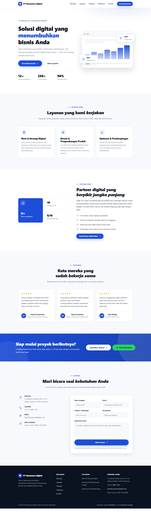

# Nusantara Landing

Tema WordPress klasik untuk **landing page perusahaan** — hero, layanan, tentang,
testimoni, ajakan bertindak, dan kontak dalam satu halaman, semuanya bisa diatur
dari Customizer tanpa menyentuh kode.



**Pratinjau langsung:** <https://fzn0x.github.io/nusantara-landing/> — versi statis
dari halaman depan, memakai markup dan CSS yang sama persis dengan temanya.
Ini cermin HTML, bukan WordPress yang berjalan, jadi formulir kontaknya tidak
mengirim apa pun.

Pratinjau itu **dibangun ulang otomatis** oleh GitHub Actions setiap kali tema
berubah di cabang `main` (lihat `.github/workflows/demo-pages.yml`), lalu
diterbitkan ke cabang `gh-pages`. Jadi ia tidak bisa basi diam-diam.

[](https://github.com/fzn0x/nusantara-landing/actions/workflows/demo-pages.yml)
[](#persyaratan)
[](#persyaratan)
[](LICENSE)

---

## Kenapa tema ini

Kebanyakan tema “serba bisa” membawa puluhan fitur yang tidak dipakai dan
memaksa Anda mematikan sebagian besarnya. Tema ini melakukan satu hal: menampilkan
profil perusahaan dengan rapi dan cepat.

- **Tanpa build step, tanpa dependensi.** Tidak ada `npm install`, tidak ada
  Composer, tidak ada permintaan ke CDN atau Google Fonts. Unggah zip, aktifkan,
  selesai.
- **Satu warna brand, turunan otomatis.** Cukup pilih satu warna di Customizer;
  versi gelap dan tint-nya dihitung sendiri lewat CSS custom properties.
- **Tidak pernah tampil kosong.** Section Layanan dan Testimoni memakai konten
  contoh sampai Anda mengisinya.
- **Aksesibel.** Skip link, focus ring, `prefers-reduced-motion`, dan
  penanda ARIA pada menu mobile serta animasi.

## Fitur

| Section | Isi |
| --- | --- |
| Header | Lengket, menu mobile, tombol CTA |
| Hero | Badge, judul, dua tombol, statistik, mockup dasbor berbasis CSS |
| Layanan | Custom post type, ikon SVG bawaan, gambar unggulan opsional |
| Tentang | Kolase statistik, daftar keunggulan |
| Testimoni | Custom post type: nama, jabatan, kutipan, foto |
| CTA | Pita gradien + tombol WhatsApp otomatis (nomor `08xx` dikonversi ke `62xx`) |
| Kontak | Alamat, telepon, email, jam layanan, formulir kirim pesan, peta opsional |
| Footer | Empat kolom + tautan sosial |

Pelengkap: blog, halaman statis, arsip, pencarian, 404, sidebar widget, dan
komentar yang sudah ditata.

## Persyaratan

- WordPress 6.0 atau lebih baru
- PHP 7.4 atau lebih baru (diuji secara statis untuk 8.x)

## Instalasi

**Lewat dasbor**

1. Unduh repo ini sebagai zip (atau ambil `nusantara-landing.zip` dari halaman rilis).
2. *Tampilan → Tema → Tambah Baru → Unggah Tema* → pilih zip → *Pasang* → *Aktifkan*.

**Lewat git** (langsung ke folder tema)

```bash
cd wp-content/themes
git clone https://github.com/fzn0x/nusantara-landing.git
```

Lalu aktifkan dari menu *Tema*.

## Mengatur isi

Buka **Tampilan → Sesuaikan → Konten Landing Page**. Di dalamnya ada panel
terpisah untuk Hero, Layanan, Tentang, Testimoni, Ajakan Bertindak, Kontak &
Sosial, Footer, dan Warna Brand.

Halaman depan dirender oleh `front-page.php`, jadi isinya diubah dari Customizer,
bukan dari editor halaman.

Dua kolom memakai format khusus:

- **Statistik** — satu baris per item, `angka | keterangan`, contoh:
  `250+ | Proyek selesai`
- **Poin keunggulan** — satu poin per baris.

### Layanan & Testimoni

Dua menu baru muncul di dasbor setelah tema aktif:

- **Layanan** — judul, deskripsi singkat (kolom *Excerpt*, atau otomatis dipotong
  dari isi), gambar unggulan opsional. Urutan diatur lewat *Atribut Halaman*.
- **Testimoni** — judul = nama, isi = kutipan, *Excerpt* = jabatan/perusahaan,
  gambar unggulan = foto.

### Formulir kontak

Formulir mengirim ke `admin-post.php` (`action=nusantara_contact`), diverifikasi
dengan nonce, disaring honeypot, dibatasi satu kiriman per 45 detik per IP, lalu
dikirim memakai `wp_mail()`.

> `wp_mail()` bergantung pada konfigurasi email server. Sangat disarankan memasang
> plugin SMTP (WP Mail SMTP, Fluent SMTP) dan mengujinya sebelum mengandalkan
> formulir ini.

Ingin memakai Contact Form 7 atau WPForms? Hapus blok `<form>` di
`template-parts/kontak.php` dan ganti dengan shortcode plugin tersebut.

## Struktur berkas

```
nusantara-landing/
├── style.css              Header tema + seluruh CSS
├── functions.php          Setup, Customizer, CPT, handler formulir, helper
├── header.php             Header + pembuka #content
├── footer.php             Footer, tombol WhatsApp, penutup #content
├── front-page.php         Susunan section halaman depan
├── index.php              Daftar artikel / arsip / pencarian
├── page.php  single.php  404.php  sidebar.php  comments.php
├── template-parts/
│   ├── hero.php  layanan.php  tentang.php
│   ├── testimoni.php  cta.php  kontak.php
│   └── content.php  content-card.php
└── assets/
    ├── css/editor.css     Gaya editor blok
    └── js/main.js         Header, menu mobile, reveal, gulir halus
```

## Kustomisasi lewat kode

```php
// Ubah urutan section halaman depan.
add_filter( 'nusantara_front_sections', function ( $sections ) {
    return array( 'hero', 'tentang', 'layanan', 'testimoni', 'cta', 'kontak' );
} );

// Tambah atau ubah opsi Customizer (id, section, type, label, default, sanitize).
add_filter( 'nusantara_fields', function ( $fields ) {
    $fields[] = array(
        'id'       => 'hero_video',
        'section'  => 'hero',
        'type'     => 'url',
        'label'    => 'Video hero',
        'default'  => '',
        'sanitize' => 'esc_url_raw',
    );
    return $fields;
} );
```

Filter lain: `nusantara_defaults`, `nusantara_content_width`.
Ikon SVG dikumpulkan di `nusantara_icon()` — tambahkan nama baru di sana untuk
memakainya di template.

## Status pengujian

Sampai rilis 1.0.0 kode ini **belum pernah dijalankan pada instalasi WordPress
sungguhan**. Verifikasi yang sudah dilakukan bersifat statis:

- keseimbangan kurung dan pasangan sintaks alternatif (`if:` / `endif:`) di 18 berkas PHP
- keseimbangan tag HTML pada tiap potongan dan pada dokumen utuh (header + halaman + footer)
- seluruh nama fungsi WordPress yang dipanggil diperiksa satu per satu
- 125 kelas template dicek terhadap `style.css`; text domain dan jangkar `#id` diverifikasi

Artinya: kemungkinan besar aman dari fatal error, tetapi **belum terbukti tampil
benar di peramban**. Uji dulu di staging sebelum dipakai di produksi, dan laporkan
apa pun yang janggal lewat Issues.

## Lisensi

GPL-2.0-or-later. Lihat [LICENSE](LICENSE).

Seluruh ikon SVG ditulis khusus untuk tema ini. Tidak ada aset pihak ketiga.
